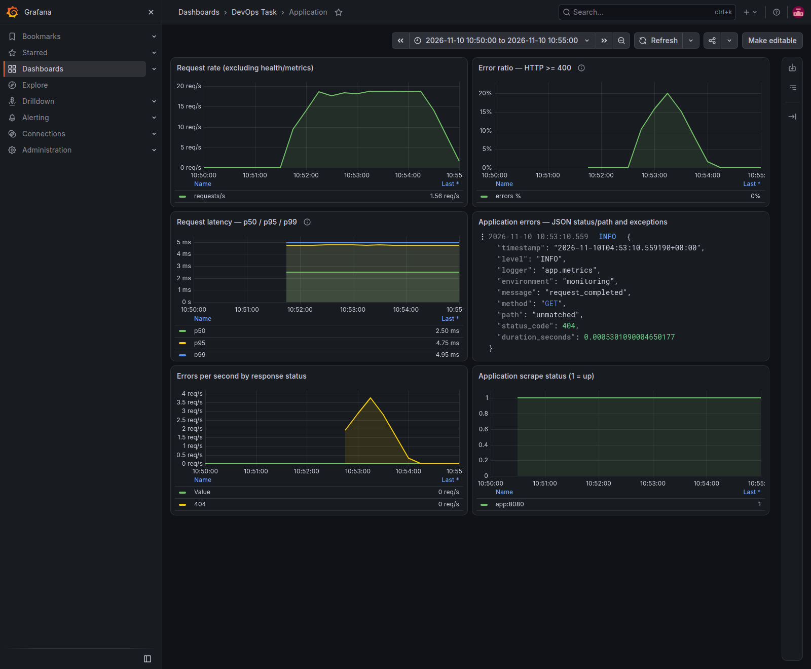
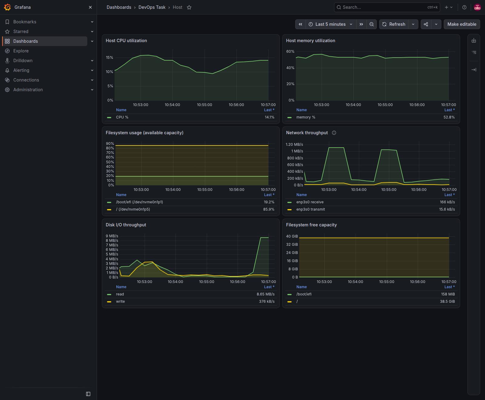
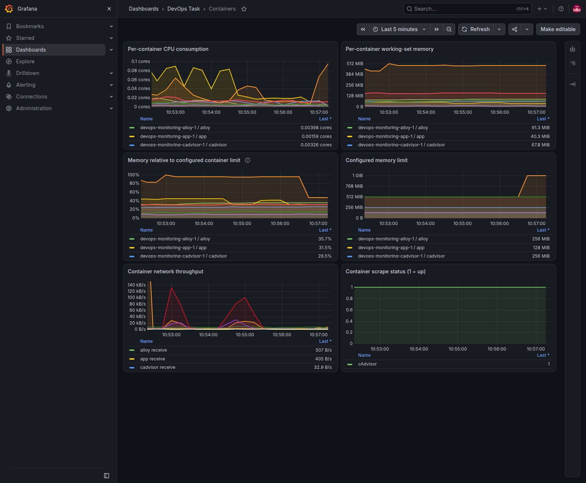

# DevOps Task — FastAPI

A small service with JSON stdout logs, Prometheus metrics, environment configuration,
and graceful SIGTERM shutdown.

## Run with Docker Compose

```sh
docker compose up --build -d --wait
curl http://localhost:8080/
curl http://localhost:8080/health
curl http://localhost:8080/metrics
docker compose logs -f app
docker compose down
```

`GET /` returns:

```json
{"message":"Hello from DevOps Task!","status":"running","version":"1.0.0"}
```

`GET /health` returns HTTP 200 with `{"status":"healthy"}` after startup,
or HTTP 503 with `{"status":"not_ready"}` outside the ready lifecycle.
The service has no external dependencies, so this endpoint serves both liveness
and readiness. During shutdown Uvicorn closes listeners and drains active requests
before running application cleanup.

`GET /metrics` returns Prometheus text exposition with:

| Metric | Meaning |
| --- | --- |
| `http_requests_total` | Completed requests by method, route, and response status |
| `http_errors_total` | Responses with status >= 400, including unhandled 500 errors |
| `http_request_duration_seconds` | Request duration histogram in seconds, including buckets, count, and sum |

All HTTP requests, including probes and scrapes, are measured. A scrape's own
measurement appears on the next scrape. Unknown URLs share the `unmatched` label
to bound metric cardinality. Counters reset on process restart. Run one process
per container and scale containers so each scrape observes a single registry.

## Configuration

All runtime configuration comes from environment variables; defaults work locally.
`.env.example` lists the variables. For a shell run, export variables explicitly;
the Python app does not automatically load `.env` files. Compose reads `.env`
for its documented substitutions.

| Variable | Default | Purpose |
| --- | --- | --- |
| `PORT` | `8080` | Listening port, 1–65535 |
| `HOST` | `0.0.0.0` | Bind address |
| `LOG_LEVEL` | `INFO` | DEBUG, INFO, WARNING, ERROR, or CRITICAL |
| `ENVIRONMENT` | `development` | Environment field in every JSON log |
| `APP_VERSION` | `1.0.0` | Version returned by `/` |
| `SHUTDOWN_TIMEOUT` | `20` | Maximum request drain time in seconds |

Compose publishes host port 8080 to container port 8080. It deliberately fixes
`PORT=8080` so its mapping and health probe stay consistent. Set `LOG_LEVEL`,
`ENVIRONMENT`, and `APP_VERSION` through shell variables or `.env` when using Compose.
The standalone image defaults to `ENVIRONMENT=production`.

## Local development and tests

Use Python 3.14 (the container uses 3.14.4):

```sh
python3 -m venv .venv
. .venv/bin/activate
pip install -r requirements.txt
pytest -q
PORT=8080 LOG_LEVEL=INFO ENVIRONMENT=development python -m app
```

Tests cover endpoint responses, readiness lifecycle, parsed metrics, HTTP errors,
registry isolation, environment validation, JSON logging, and a real subprocess
receiving SIGTERM. The shutdown test needs permission to bind a loopback port.
Start with `python -m app` to apply the environment-based server and logging setup.

## Container design and measured size

The multi-stage Dockerfile installs runtime dependencies into a virtual environment
and copies it and the application into an Alpine runtime. Both stages pin Python
3.14.4 / Alpine 3.23 by version and SHA-256 digest. The shared `requirements.txt` includes application, test, and lint dependencies;
all are installed in the image. Other repository files are excluded from the
build context by an allowlist `.dockerignore`.
The image runs as UID/GID `10001:10001`, has OCI metadata, a Python standard-library
health probe, and an exec-form entrypoint so SIGTERM reaches Uvicorn directly.

**Measured final image size: 192,217,941 bytes (192.2 MB / 183.31 MiB), linux/amd64.**
This is the local image size reported by Docker, not compressed registry transfer
size. Architecture and dependency updates can change it. Reproduce the measurement:

```sh
docker build -t devops-task:1.0.0 .
docker image inspect devops-task:1.0.0 --format '{{.Size}}'
```

Optional build arguments `APP_VERSION` and `VCS_REF` populate OCI version/revision
labels. `APP_VERSION` also supplies the image's runtime version default.

Compose applies a restart policy, a read-only root filesystem, a 16 MB temporary
filesystem, dropped capabilities, no-new-privileges, rotated container logs, and
limits of 0.5 CPU, 128 MiB memory, and 64 PIDs. Its 30-second stop grace period exceeds
the application's default 20-second drain timeout. Keep the stop grace period
larger than `SHUTDOWN_TIMEOUT` when changing these settings.

Implementation references: [Uvicorn server settings](https://uvicorn.dev/settings/)
and the [Prometheus Python client histogram documentation](https://prometheus.github.io/client_python/instrumenting/histogram/).

## CI/CD workflows

Pull requests run linting, tests with an 85% coverage gate and downloadable reports,
Dockerfile/ShellCheck linting, and a Trivy image scan that blocks CRITICAL findings.
Pushes to `production` pass those checks, publish amd64/arm64 images to ECR with commit
SHA and semantic version tags, and deploy via GitHub OIDC and SSM with health-based
rollback. See [AWS and CI/CD setup](docs/terraform.md) for required GitHub variables, IAM policies,
EC2 prerequisites, tagging, rollback behavior, and deployment evidence. No GitHub
secrets or long-lived AWS access keys are required.


## Development and production branches

Use `feature/*` → pull request into `development` → pull request into `production`.

| Event | Checks | Publish and AWS deployment |
| --- | --- | --- |
| Pull request into any branch | Full CI | No |
| Push or merge into `development` | Full CI | No |
| Push or merge into `production` | Full CI, then release | Yes, after checks pass |

Create `development` and `production` branches in GitHub if they do not exist.
Protect both branches with required CI checks and PR reviews. Set the GitHub
`production` environment's deployment branch rule to allow only `production`.
The environment name remains `production`; OIDC trust using the environment
subject remains unchanged. AWS configuration is required only for the production
release job. Development CI runs without AWS credentials.


## Step 3: Terraform on AWS

The `terraform/` root provisions an EC2 deployment target for `staging` or
`production`, with its own VPC, approved-client access to port 8080, instance IAM
permissions, Docker bootstrap, and CloudWatch container logging with retention.
`terraform/bootstrap/` provisions the private/versioned S3 state bucket; the app
uses separate environment state keys and S3 lock files. No static AWS keys are used.

Follow [the Terraform guide](docs/terraform.md) for SSO authentication, initial ECR
publishing, backend setup, plan/apply, health/log checks, and destroy commands.
Both roots pass validation; [offline test output](docs/evidence/terraform-test.txt)
records four mocked plan tests. **No real AWS plan/apply has been run** because no
AWS account/access was provided. These tests are not evidence of an AWS apply.

## Step 4: Local Kubernetes

Manifests under `k8s/` provide two replicas, a rolling update with
`maxUnavailable: 0` / `maxSurge: 1`, startup/liveness/readiness probes, resource
requests/limits, a ConfigMap, an empty Secret template, a ClusterIP Service, and a
CPU HPA (70% utilization, 2–4 replicas). Pods run as UID 10001 with a read-only root
filesystem, dropped capabilities, seccomp, no service-account token, and a small
memory-backed `/tmp`. A five-second preStop delay allows endpoint changes to
propagate before SIGTERM; the 35-second termination grace period leaves time for
the app's 20-second drain. At least three pods must fit during an update.

Install Docker, kind, and kubectl. The measured demonstration uses kind v0.33.0,
Kubernetes v1.35.0, and kubectl v1.35.0. Use a separate kubeconfig to avoid changing
your usual cluster context:

```sh
export KUBECONFIG=/tmp/devops-task-kubeconfig
kind create cluster --name devops-task --image kindest/node:v1.35.0 --config k8s/kind/cluster.yaml

docker build --build-arg APP_VERSION=1.0.0 -t devops-task:1.0.0 .
docker build --build-arg APP_VERSION=1.1.0 -t devops-task:1.1.0 .
kind load docker-image devops-task:1.0.0 devops-task:1.1.0 --name devops-task

kubectl apply -f https://github.com/kubernetes-sigs/metrics-server/releases/download/v0.8.1/components.yaml
# Local kind only: its kubelet certificate is not trusted by Metrics Server.
kubectl -n kube-system patch deployment metrics-server --type=json -p '[{"op":"add","path":"/spec/template/spec/containers/0/args/-","value":"--kubelet-insecure-tls"}]'
kubectl -n kube-system rollout status deployment/metrics-server --timeout=180s

kubectl apply -k k8s/
kubectl -n devops-task rollout status deployment/devops-task --timeout=180s
kubectl -n devops-task port-forward service/devops-task 8080:8080
# In another terminal:
curl --fail http://localhost:8080/health
```

Port-forward is the supported local access method. `k8s/ingress.yaml` is optional
and excluded from Kustomize: it requires an installed controller, a matching
`ingressClassName`, and DNS/hosts setup for `devops.local`. Port-forward binds to a
pod and can end when that pod is replaced; the availability demonstration instead
sends requests through the Service from inside the cluster.

### Secret handling

`secret.example.yaml` contains **no credential values**. The application currently
requires no secrets; an empty Opaque Secret lets the manifest run as-is. If a future
integration requires credentials, create/update it from an ignored, owner-readable
file locally; do not put values in shell command arguments or commit encoded YAML:

```sh
# Create app.secret.env with your actual required keys using your editor; chmod 600.
kubectl -n devops-task create secret generic devops-task-secrets --from-env-file=app.secret.env --dry-run=client -o yaml | kubectl apply -f -
kubectl -n devops-task rollout restart deployment/devops-task
```

Base64 is not encryption. Restrict Kubernetes Secret access with RBAC. The app must
implement any new configuration key before it has an effect. The empty template
is for local testing; omit it from production overlays so reapplying Kustomize does
not overwrite externally managed credentials. Environment changes require pod
replacement. HPA needs Metrics Server; `kubectl top pods -n devops-task` and
`kubectl get hpa -n devops-task` verify the CPU metrics path.

### Rolling update and rollback demonstration

With both versions loaded, run the repeatable demonstration:

```sh
bash scripts/k8s_demo.sh
```

It applies the manifests, starts an in-cluster request probe for 90 seconds, then
runs these commands while requests continue:

```sh
kubectl -n devops-task set image deployment/devops-task app=devops-task:1.1.0
kubectl -n devops-task rollout status deployment/devops-task --timeout=180s
kubectl -n devops-task rollout undo deployment/devops-task
kubectl -n devops-task rollout status deployment/devops-task --timeout=180s
kubectl -n devops-task logs rollout-probe
```

Actual output from the local run (2026-11-10; full transcript linked below):

```text
deployment.apps/devops-task image updated
deployment "devops-task" successfully rolled out
NAME          READY   UP-TO-DATE   AVAILABLE
devops-task   2/2     2            2
deployment.apps/devops-task rolled back
deployment "devops-task" successfully rolled out
{"successes": 868, "failures": 0, "versions": {"1.0.0": 686, "1.1.0": 182}}
```

Across the update and rollback, all **868 sampled requests succeeded**, and the
probe observed both image versions. HPA reported live CPU utilization with two
replicas. The temporary kind cluster was deleted after collecting evidence.

This is observed availability for the measured request stream, not a guarantee
under all loads or node failures. The probe fails if any request fails or if it
does not observe both versions. [Full captured output](docs/evidence/kubernetes-rollout.txt)
includes rollout status and revision history. HPA metrics are recorded separately
in [cluster evidence](docs/evidence/kubernetes-status.txt).

Clean up after testing:

```sh
kind delete cluster --name devops-task
```

### Production on EKS

Use private worker subnets across Availability Zones, ECR image digests, and an
AWS Load Balancer Controller/ALB with ACM TLS and real DNS in place of port-forward.
Spread replicas across nodes/AZs and add a PodDisruptionBudget. Size requests from
measurements; retain HPA for pods and use Karpenter or Cluster Autoscaler for node
capacity, including surge capacity during releases. Install Metrics Server with
trusted kubelet certificates, without the local insecure-TLS flag. Ship logs with
Fluent Bit/CloudWatch and monitor application metrics.

Store secrets in AWS Secrets Manager with External Secrets or the Secrets Store
CSI driver; use dedicated service accounts with scoped IRSA or EKS Pod Identity
roles for controllers/workloads that access AWS. This app currently needs no AWS
permissions inside its pods. Use RBAC, encrypted secrets at rest, NetworkPolicies,
and a supported network policy provider. Promote signed/scanned image digests
through environment overlays and retain rollout evidence. AWS documents the
[IRSA and Pod Identity options](https://docs.aws.amazon.com/eks/latest/userguide/service-accounts.html);
Kubernetes documents the [rolling update controls](https://kubernetes.io/docs/concepts/workloads/controllers/deployment/).

## Step 5: Local monitoring and logging

The standalone `docker-compose.monitoring.yml` runs the app and all six mandatory
components: **Prometheus, Grafana, Loki, Grafana Alloy, Node Exporter, and cAdvisor**.
Use it by itself, rather than merging it with the main Compose file (which
publishes the app's port). On native Linux with Docker Engine:

```sh
# If .env does not exist yet:
cp -n .env.example .env
chmod 600 .env
# Edit .env and set a unique GRAFANA_ADMIN_USER and GRAFANA_ADMIN_PASSWORD.
# Both are required; there are no default admin credentials in Compose.
docker compose -f docker-compose.monitoring.yml up --build -d
```

Open **http://127.0.0.1:3000** and sign in with your `.env` credentials. This
workspace's local `.env` has a generated password; it is ignored by Git. In
Grafana open **Dashboards → DevOps Task**. Data sources and all three dashboards
are provisioned from `monitoring/grafana/`; no UI setup or dashboard import is
needed. Allow 30–60 seconds for discovery/scrapes and rate calculations.

Only Grafana publishes a host port, bound to loopback. The app, Prometheus, Loki,
Alloy, Node Exporter, and cAdvisor use an `internal: true` Docker network with no
published ports. Grafana also joins a frontend bridge so Docker can forward its
localhost port. Metrics and logs stay on the internal network. To verify the app
without publishing it:

```sh
docker compose -f docker-compose.monitoring.yml exec -T app python -c 'import urllib.request; print(urllib.request.urlopen("http://app:8080/health").read().decode())'
```

Image pins are explicit in Compose: Prometheus `v3.16.0`, Grafana `13.3.0`, Loki
`3.7.9`, Alloy `v1.21.3`, Node Exporter `v1.12.1`, and cAdvisor `0.60.6`.
The local app uses `devops-task:1.0.0`. Grafana has a 1 GiB limit to allow dashboard-rendering headroom.
All seven containers have memory limits, a restart policy, and rotated Docker JSON logs (10 MB × 3 files per container).
This monitoring deployment deliberately uses Docker `json-file` logging; the AWS
EC2 deployment uses CloudWatch instead.

### Collection and retention

Prometheus scrapes every 15 seconds: the app's `/metrics`, Node Exporter, and
cAdvisor, plus Prometheus/Loki/Alloy self-metrics. Rules evaluate every 15 seconds.
Prometheus retains **7 days**, with a **2 GB** TSDB retention-size threshold;
whichever threshold is reached first expires older blocks. The size threshold is
not a hard filesystem quota: WAL/head data and block cleanup need extra space.

Loki uses a single-node filesystem/TSDB v13 store with **168-hour (7-day)** retention
and 24-hour index periods. Its compactor runs every 10 minutes, with retention
enabled and a two-hour deletion delay; physical deletion is asynchronous. Loki
has no disk-size cap here, so watch host filesystem usage. Both retain data in
named volumes. Grafana's database and Alloy's Docker log positions are also
persisted in named volumes. See the
[Loki retention documentation](https://grafana.com/docs/loki/latest/operations/storage/retention/).

Alloy uses Docker service discovery without a project filter and tails **all
running containers**, including containers outside this Compose project. Its
Docker source unwraps the Docker transport; the JSON stage parses the app's
original structured message. Do not add another Docker envelope parser to this
source. Indexed log labels are stable `project`, `service`, and (for this app)
`level`. Loki may also derive the bounded `service_name` label. Standalone
containers fall back to `project="standalone",service="docker"`. Container IDs,
request IDs, raw URLs, timestamps, and messages are not indexed labels.

App `level` has a small bounded set of values. Request `path` and `status_code`
remain in the original JSON and can be extracted with LogQL `| json` at query time;
this avoids a stream for every path/status combination. The app already normalizes
unknown routes to `unmatched`. A future route containing user IDs should likewise
use a route template. Prometheus keeps only the useful Compose project/service
labels from cAdvisor's container labels. This limits label cardinality while
preserving per-container metrics through cAdvisor's `name`/`id` series.
See [Alloy's Docker log source](https://grafana.com/docs/alloy/latest/reference/components/loki/loki.source.docker/).

### Provisioned dashboards and screenshots

These are actual screenshots from this local stack, not mockups. The sample
traffic included 225 intentional HTTP 404 responses among 3,367 requests; no
server failure was injected. The dashboards count HTTP >= 400 as errors, matching
the app's metrics. Probe and scrape traffic are excluded from application rate,
error, and latency panels. Percentiles are histogram estimates with the app's
configured buckets, not exact latency samples.

**Application:** request rate, error percentage, errors/second by response status,
p50/p95/p99 latency, and scrape availability. Its Loki failed-request/exception log panel is alongside the
latency/error metrics so the same time window can be investigated.



**Host:** CPU utilization, available-memory utilization, filesystem usage/free
space, disk I/O, and network throughput from Node Exporter.



**Containers:** per-container CPU cores, working-set memory, actual configured
memory limit, memory as a percentage of that limit, and network throughput from
cAdvisor. All stack containers have finite limits; zero/unbounded sentinel limits
are excluded from the percentage panel.



### Alert rules and threshold choices

Four Prometheus alerts live in `monitoring/prometheus/alerts.yml`. Recording rules
in `rules.yml` compute five-minute application rates. These are starting thresholds
for this small service, to be tuned against real traffic and service objectives.

| Alert | Condition | `for` | Reasoning |
| --- | --- | --- | --- |
| AppInstanceDown | App scrape `up == 0` | 1 minute | Four missed 15-second scrapes indicate sustained unavailability while allowing a short restart or transient connection failure. `/health` can then distinguish app readiness from scrape access problems. |
| HighApplicationErrorRate | HTTP >= 400 exceeds 5% over five minutes, with > 1 request/second | 5 minutes | A sustained error fraction merits investigation; the traffic floor prevents one failed low-volume request from paging. Includes client errors, so inspect status codes before concluding there is a server bug. Health/scrape requests are excluded. |
| HostDiskUsageHigh | Writable real filesystem exceeds 80% usage, based on available bytes | 10 minutes | Leaves approximately 20% headroom for logs/TSDB/WAL growth and filters brief temporary writes. Pseudo-filesystems and read-only mounts are excluded. |
| ContainerMemoryNearLimit | Working set exceeds 90% of an exported finite memory limit | 5 minutes | Less than 10% headroom raises OOM risk. Five minutes avoids most short allocation/cache spikes; zero and unbounded sentinel limits are excluded. |

The error alert uses both a five-minute rate window and a five-minute pending
period, so a short demonstration spike need not reach firing state. The rules are
loaded and evaluated by Prometheus; notifications are **not dispatched** without
an Alertmanager/receiver, which is outside this six-component stack. Inspect rule
state through Grafana Explore using the Prometheus expression `ALERTS`, or through
the authenticated datasource proxy:
`http://127.0.0.1:3000/api/datasources/proxy/uid/prometheus/api/v1/rules`.

Rule unit tests cover all four firing conditions and confirm the high-error alert
stays pending before its duration elapses. They also verify low-traffic and
unbounded-memory exclusions:

```sh
docker compose -f docker-compose.monitoring.yml exec -T prometheus promtool check config /etc/prometheus/prometheus.yml
docker compose -f docker-compose.monitoring.yml exec -T -w /etc/prometheus prometheus promtool test rules alerts.test.yml
```

### Finding the cause of an error spike

1. On **Application**, drag over the spike to select its time interval. Compare
   request volume, error percentage, and the status-code series. Rising 404s often
   indicate a client/route problem; rising 500s point toward request processing.
   Compare p95/p99 latency to see whether errors coincide with slower requests.
2. Read the adjacent Loki panel for that same interval. Open it in Explore for
   filters. Find all failed requests with:

   ```logql
   {project="devops-monitoring",service="app"} | json | status_code >= 400
   ```

   Narrow to a route using an extracted field (a query filter, not an indexed path
   label):

   ```logql
   {project="devops-monitoring",service="app"} | json | path="unmatched" | status_code=404
   ```

   For exceptions or application error messages, use:

   ```logql
   {project="devops-monitoring",service="app",level="ERROR"} | json
   ```

   A completed failed request is currently logged at INFO with its `status_code`,
   so filtering only `level="ERROR"` would miss expected 4xx responses. Unhandled
   exceptions produce separate ERROR logs with an exception field. In the sample
   screenshots, the deliberate missing route produces `path="unmatched"` and
   `status_code=404`; this is a controlled client error, not an application crash.
3. Open **Containers** at the same time range. Check whether app CPU saturated or
   working-set memory approached its limit, and compare the other containers.
   Check container restart/state using `docker compose -f
   docker-compose.monitoring.yml ps` and logs if metrics disappear.
4. Open **Host** to correlate host CPU, available memory, disk space/I/O, and
   network throughput. If multiple containers struggle together, host pressure is
   more likely than an isolated request handler problem.
5. For missing logs, inspect Alloy's logs and Loki readiness; for missing metrics,
   query `up` in Grafana Explore and inspect exporter/Prometheus logs with
   `docker compose -f docker-compose.monitoring.yml logs --tail=100 SERVICE`.
   Apply the appropriate app/config/resource fix and confirm error rate and
   latency return to baseline. Keep the same time window as incident evidence.

To reproduce the local spike and check the full collection path:

```sh
docker compose -f docker-compose.monitoring.yml exec -T app python - --duration 180 < scripts/monitoring_traffic.py
python3 scripts/verify_monitoring.py
```

The verifier uses environment variables or the ignored `.env` to authenticate to
Grafana. It checks all six scrape targets, every dashboard metric expression,
provisioning status, logs from all seven containers, JSON/status filtering, and
healthy alert rules. [Captured verification output](docs/evidence/monitoring.txt)
is included. CI validates Compose, dashboard JSON, all three collector configs,
alert tests, and shell scripts. Screenshot layouts may change across Grafana
versions; committed JSON remains the source of truth.

### Host access and security boundaries

| Component | Host access granted | Purpose and limits |
| --- | --- | --- |
| Node Exporter | Host PID namespace; `/:/host:ro,rslave`; no added capabilities; read-only root filesystem and a 1 MB `/textfile` tmpfs | Reads the host's proc/sys/filesystem data. `rslave` lets host mount changes be observed without propagating container mounts back. Host PID access exposes process metadata, so this is a trusted observer. |
| cAdvisor | `privileged: true`; read-only mounts of `/` at `/rootfs`, `/sys`, `/var/run`, and `/var/lib/docker` | Reads cgroups, container metadata/socket, and storage information on this Linux/cgroup-v2 host. Privileged mode grants broad kernel/device access and is a local assessment convenience, not a strong isolation boundary. No `/dev/kmsg` or `/dev/disk` mount was needed for the required CPU/memory metrics. |
| Alloy | Runs as root with `/var/run/docker.sock:ro` | Docker discovery and log-stream access for all containers. A read-only socket mount does **not** make Docker's API read-only; possession of this socket can control Docker and is effectively host-level authority. |

Node Exporter's normal network collector would observe the exporter's bridge
namespace. To keep its HTTP endpoint off the host while collecting actual **host**
network usage, `monitoring/node-exporter/entrypoint.sh` reads
`/host/proc/1/net/dev` every five seconds and exposes counters through the standard
Node Exporter textfile collector. The dashboard uses these
`node_host_network_*_bytes_total` counters, excluding loopback/Docker bridge/veth
interfaces to avoid repeatedly counting the same traffic. CPU/memory/disk metrics
use Node Exporter's regular collectors with the host proc/sys/rootfs paths.
`node_textfile_scrape_error` and the textfile modification time help diagnose a
failed collector. No host-network mode or extra published exporter port is used.

These mounts expose host metadata, files, and Docker logs. Run this trusted stack
on a dedicated development Linux host. Docker Desktop reports metrics for its
Linux VM, not the macOS/Windows host; rootless Docker or different storage paths
may require mount/permission changes. For a shared/production environment, reduce
cAdvisor privileges after testing on that platform, replace direct Docker socket
access with an API-filtering proxy, and protect Grafana with TLS/authentication and
Loki with an authenticating gateway. Loki authentication is disabled only because
it has no public endpoint in this isolated local setup. Do not put credentials
or sensitive request payloads in application logs.

Grafana initializes admin credentials from the environment on first startup; its
persisted database retains password changes. Merely editing `.env` does not rotate
an existing admin account—use Grafana's account/admin password-reset procedure.
`.env` must remain ignored and readable only by its owner.

Stop the stack while retaining metrics/logs/dashboards:

```sh
docker compose -f docker-compose.monitoring.yml down
```

For a deliberate complete local reset, append `--volumes`; this permanently deletes
this stack's metrics, logs, Grafana database, and Alloy positions. Save evidence
first. The application-only Compose setup remains available separately.
